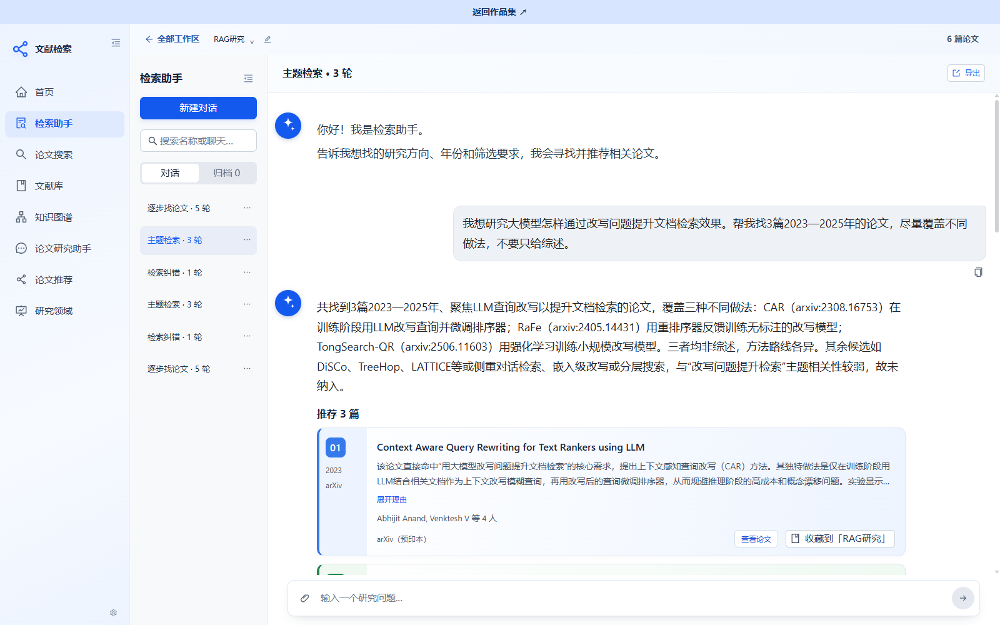
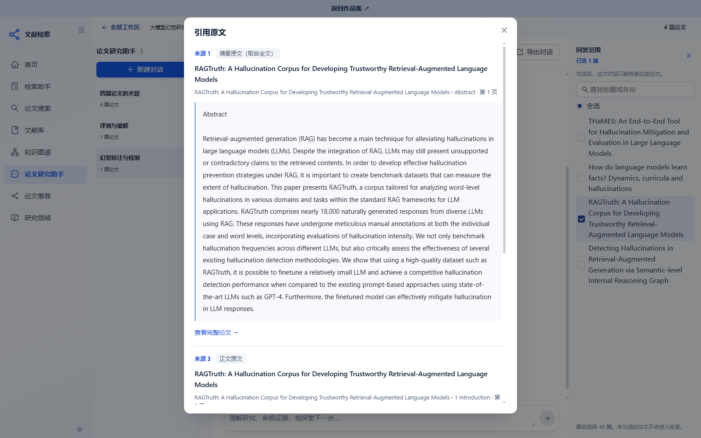
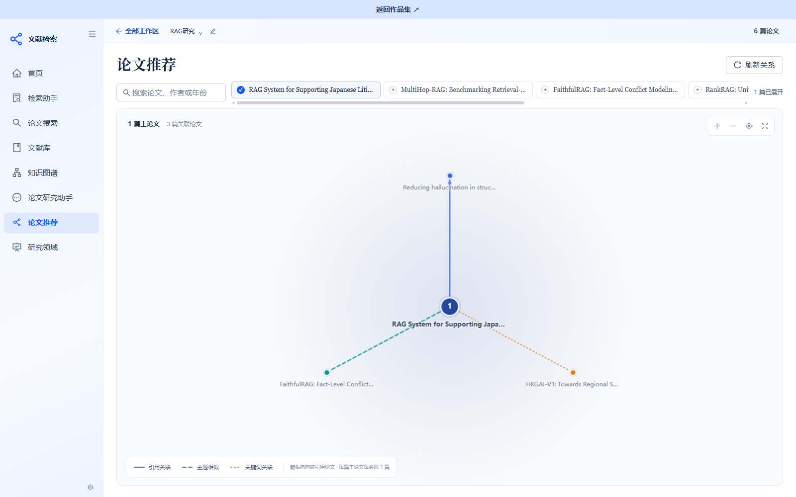
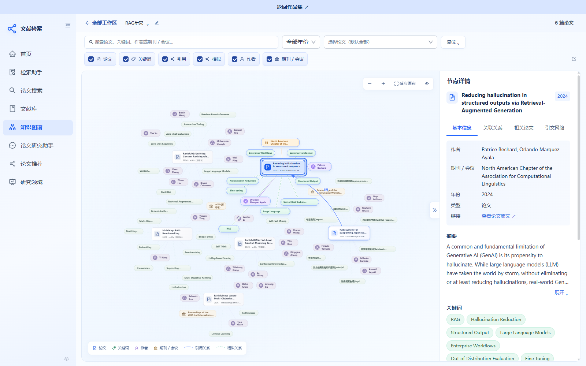
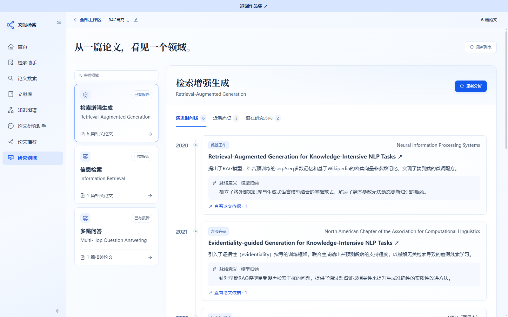

# 文献检索与研究平台

面向文献调研，把**找论文、研究论文、推荐论文、梳理研究领域**放进同一个工作区。

不知道该读什么时，用研究方向和筛选条件逐步寻找论文；选定论文后，从方法、实验、局限和观点差异展开研究。回答中的引用可以直接打开原文片段，帮助读者形成自己的判断。

**论文是研究证据的来源，不是真理本身。** 系统区分作者陈述、实验支持的结论与研究建议，不把缺少证据的推测包装成事实。

[在线使用](https://papers.chenwj.click/) · [部署说明](deploy/README.md)

## 开始使用

打开设置页，在“大模型”中选择服务商，填写 API 地址、模型名称和自己的 API Key；按需补充向量与重排、MinerU、Semantic Scholar 配置，点击“保存配置”。后续请求立即使用已保存的配置。

在线实例按浏览器会话隔离配置、论文和对话。密钥保存在该会话的服务端存储中，不回显到页面，也不会提供给其他访问者。清除 Cookie 后会建立新的会话，需要重新配置。

自行部署也可使用服务端 `.env` 配置。默认从空工作区开始，不包含作者的 API Key 或私人数据库。

## 能做什么

| 能力 | 使用方式 |
| --- | --- |
| 检索助手 | 描述研究方向、年份和筛选要求，再多轮调整；结果按论文卡片展示，附推荐理由 |
| 论文搜索与文献库 | 搜索 arXiv、Semantic Scholar；查看元数据、导入论文并按工作区组织 |
| 论文研究助手 | 在勾选范围内分析研究动机、方法、实验、局限，支持多论文比较与开放式研究讨论 |
| 引用溯源 | 点击“来源 1、2”同时查看对应原文、论文标题及已有章节、页码，不离开对话 |
| 论文推荐 | 展示引用关联、主题相似和关键词关联；引用与算法推断的相似关系分别标识 |
| 知识图谱 | 连接论文、作者、关键词和期刊会议；支持筛选、缩放和节点详情 |
| 研究领域 | 整理领域标签与报告，查看研究脉络、热点和潜在研究方向，并保留论文依据 |

## 项目截图

以下均为实际运行页面，使用公开论文构建的示例工作区。截图中的论文和对话不会在部署后自动创建。

### 从研究方向逐步找论文



### 研究论文，并直接核对引用原文



### 区分论文引用与相似关系



<details>
<summary>查看知识图谱与研究领域截图</summary>





</details>

## 研究问答怎样工作


- **有需要再规划**：简单问题直接检索，复杂比较或研究问题按需改写、拆解；证据不足最多纠正检索一次。
- **多论文独立取证**：每篇所选论文都有检索机会；证据不足时说明缺失，不用一篇的内容代替整个论文集合。
- **结构感知与父子分块**：基于保存的 Markdown，优先保留章节、段落、表格与公式边界。默认子块 350 tokens、重叠 50 tokens、父块 1,000 tokens，按 Embedding 输入限制校验。
- **两种索引各司其职**：QA 的 SQLite 子块向量与 FTS5 共用边界；相似推荐所用 FAISS 索引单独维护。
- **保留证据边界**：全文解析成功后建立 QA 索引；失败时保留摘要问答，并明确可用资料范围。
- **范围隔离**：研究助手按本次所选论文检索，历史对话不会扩大当前论文范围。检索助手则负责寻找新的公开论文。
- **复核而非真理判定**：Judge 检查论述是否有材料支持，不代表论文结论经过独立复现实验或外部事实核验。

实现与验收细节见 [研究问答流程](docs/qa-workflow-audit.md)、[父子分块](docs/qa-parent-child-audit.md) 和 [研究助手原则](docs/research-assistant-policy.md)。

## 技术栈

| 层次 | 实现 |
| --- | --- |
| 前端 | React 18、TypeScript、Vite、Ant Design、Markdown/数学公式渲染、SVG 图谱交互 |
| 后端 | Python 3.12、FastAPI、LangGraph、异步后台任务 |
| 存储与检索 | SQLite、FTS5、FAISS、RRF、BGE Embedding 与重排 |
| 论文与全文 | arXiv、Semantic Scholar、MinerU |
| 模型接入 | 服务端 OpenAI-compatible 接口，需支持相应 JSON 输出或工具调用 |
| 部署 | Docker Compose、Nginx；支持单人部署与会话隔离模式 |

## 快速开始

需要 Python 3.12、Node.js 20+，以及 [uv](https://docs.astral.sh/uv/)。

```sh
git clone https://github.com/cwj-66/literature-search.git
cd literature-search
uv venv --python 3.12
uv pip install -r backend/requirements.txt
```

复制 `.env.example` 为 **`backend/.env`** 并配置需要的服务：

```sh
# Windows PowerShell
Copy-Item .env.example backend/.env
.\.venv\Scripts\python.exe -m uvicorn app.main:app --app-dir backend --reload --port 8000
```

macOS/Linux 使用 `cp .env.example backend/.env`，启动命令中的 Python 路径改为 `.venv/bin/python`。

另开终端：

```sh
cd frontend
npm ci
npm run dev
```

访问 `http://localhost:5173`。Vite 将 `/api` 转发到本地 8000 端口。未配置模型也可查看界面、使用公开检索接口；AI 与向量功能需要相应服务。

### 配置服务

| 配置 | 用途 |
| --- | --- |
| `DASHSCOPE_API_KEY`、`DASHSCOPE_BASE_URL`、`LLM_MODEL` | 大模型服务；变量沿用原命名，接入兼容协议的服务需验证模型输出格式 |
| `SILICONFLOW_API_KEY`、`SILICONFLOW_EMBEDDING_MODEL`、`RERANK_MODEL` | 向量与重排，当前默认 `BAAI/bge-m3`、`BAAI/bge-reranker-v2-m3` |
| `MINERU_API_TOKEN` | MinerU 全文解析 |
| `SEMANTIC_SCHOLAR_API_KEY` | 可选；不填使用公开接口，可能限流 |
| `QA_CHILD_TOKENS`、`QA_CHILD_OVERLAP_TOKENS`、`QA_PARENT_TOKENS` | QA 切分参数，默认 350 / 50 / 1,000 |
| `LLM_FALLBACK_MODELS`、`LLM_FALLBACK_STATE` | 可选的额度耗尽切换顺序与持久状态文件，不会因普通限流或超时切换 |

网页保存的配置立即生效，密钥不回显。`.env` 环境变量变更后需重启后端。会话托管模式仅使用当前用户的密钥，不继承主机的付费凭据。更换 Embedding 模型还需匹配 tokenizer、输入上限并重建相关索引，不能只更改模型名称。

### Docker 部署

普通单人部署：复制 `.env.example` 为 `deploy/.env`，然后执行：

```sh
docker compose -p paper-search -f deploy/compose.yml up -d --build
```

API 仅绑定 `127.0.0.1:15179`。前端另行 `npm run build`，由 Nginx 提供静态文件。Nginx 与会话托管模式的配置见 [部署说明](deploy/README.md)。

## 验证

后端测试依赖需另行安装：`uv pip install pytest pytest-subtests`。

```sh
cd backend
../.venv/bin/python -m pytest tests/test_qa_workflow.py tests/test_qa_parent_child.py tests/test_qa_fulltext_index.py tests/test_research_assistant_policy.py tests/test_provider_settings.py
```

Windows 将 Python 路径改为 `..\\.venv\\Scripts\\python.exe`。更多既有离线回归可用 `python backend/tests/run_offline.py`；它使用 unittest 发现规则，不包含所有 pytest 风格测试。

```sh
cd frontend
npm run build
npm run test:research
```

模拟测试用于验证程序行为，不能替代真实论文的回答与引用验收，也不能保证第三方服务始终可用。

本次验证范围和历史测试未通过项见 [验证状态](docs/verification-status.md)，没有以部分回归结果宣称全量通过。

## 使用边界

- 会话模式提供匿名浏览器隔离，不是完整账户系统；正式服务仍需补充账户恢复、访问控制及运维策略。
- 上游限流、全文不可访问、解析失败和证据不足都会影响结果；页面应保留这些真实状态。
- 引用量、分区、会议等级和论文关系依赖来源与覆盖情况，不将缺失数据补成确定结论，不把语义相似当作真实引用。
- 截图所含论文内容与公开来源素材的权利归各自权利人；模型和论文 API 仍须遵守服务提供方的条款。

许可证尚未指定；公开可见不等于已授权任意复制、再发布或商用。
