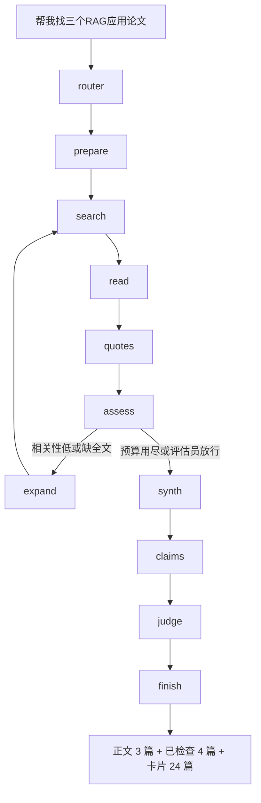

# Agent 诊断：思考逻辑、篇数和展示

诊断日期：2026-10-19。样本问句：「帮我找三个有关 RAG 的应用的论文」。

根因是同一件事：**“找 N 篇论文”没有被当成书目检索，而是走了为综述和核验证据设计的整条流水线；界面再把检索池原样铺出来。** 过程很长且自我否定、只要 3 篇却出现 24 篇、观感不像“直接给论文”，是这条链上的三个出口。

## 实际走了哪条路

研究任务不走自由 ReAct。路由之后固定进入证据流水线（[`backend/app/agents/agent.py`](../backend/app/agents/agent.py) 的 `build()`，[`research-workflow.md`](research-workflow.md)）：



[`research-workflow.md`](research-workflow.md) 第 51–52 行写了边界：搜索时默认用摘要，用户要细节才读全文；书目可以覆盖更多候选，但不能说这些论文都读过。代码没有遵守这条边界。`search_literature` 之后无条件进入 `read_paper`，再进入 `extract_quotes`。

## 1. 思考逻辑

**数量不是停止条件。** 评估员提示把“相关性低”和“缺全文”都定义成继续搜、继续读（[`prompts.py`](../backend/app/agents/prompts.py) 的 `ASSESS_SYSTEM`）。`assess_route` 只看 `next_action` 和预算，不看用户要几篇。默认预算是初始检索加 2 次补检索、深读 5 篇、评估 4 次，所以“找 3 篇”会走出一长串步骤。

**“找论文”被当成“证实论文”。** 抽引文要求片段与问题直接相关，没有就返回空列表（[`workflow.py`](../backend/app/agents/workflow.py) 的 `quote_node`）。空结果记成 `basis: unavailable`，缺口写成“未找到相关原文”。摘要阅读还会写入“不能确认正文实验细节”。综合节点规定元数据只能支持书目，摘要不能支持实验细节。Judge 按同一套规则降级。助手找到题名明显是 RAG 应用的论文，仍回答“只能确认题名和主题，不能确认是不是应用论文”。用户要的是书目，系统用综述的证据标准给自己判失败。

**第一轮会被判跑题，然后越搜越宽。** 标题漂移：检索式里的英文词在前 5 篇标题覆盖率低于 20%，就 `search_more`。规则改写会丢掉最后一个 AND 组。中文问句“RAG 的应用”若没被规划成稳定的英文检索式，`application` 这类词进不了标题，就会触发补检索，应用约束反而被拆掉。样本里的“当前 4 篇与 RAG 应用无关 → 补充检索 → 又读又核对”就是这条回路。

**过程日志是节点流水账。** [`ResearchConversation.tsx`](../frontend/src/pages/workspace/ResearchConversation.tsx) 把每个 `read` / `quotes` 事件各打一行。4 篇论文就是 4 次“阅读”加 4 次“核对原文依据”，看起来像在空转。

## 2. 为什么是 24 篇，不是 3 篇

24 不是写死的展示上限。卡片渲染的是整份候选池 `state.papers`，24 是这次合并后的池子长度。

数量解析只认数字紧挨着“篇”（[`agent.py`](../backend/app/agents/agent.py)）：

```python
QUANTITY_HINT = re.compile(r"([0-9一二两三四五六七八九十]{1,3})\s*篇(?:论文|文献|文章)?")
```

“三个有关 RAG 的应用的论文”中间隔着主题词，匹配不上。“三篇关于 RAG 的论文”才能匹配。测试也只覆盖了“三篇关于…”这种紧邻写法（[`test_pool_caps.py`](../backend/tests/test_pool_caps.py)）。

就算匹配上，也只在 `react_node` 里写入 `result_limit`。这次走的是研究工作流，`plan_node` 不调用 `_result_hint`，状态里的 `result_limit` 一直是 `None`。

`result_limit` 即便有值，也只约束两处：登记元数据证据时切片、综合失败时的标题列表。它不截 `public_state` 交出去的 `papers`。前端原样铺开（[`ResearchConversation.tsx`](../frontend/src/pages/workspace/ResearchConversation.tsx)）：

```tsx
<p className="small-print">本次涉及的论文。下面是前 {turn.papers.length} 篇，可以收藏到这个工作区。</p>
{turn.papers.map(paper => /* 卡片 */)}
```

`turn.total` 在类型里有、赋值路径里没有，所以“找到 N 篇”永远不出现。句式是“下面是前 24 篇”，这里的“前”没有截断，24 就是全部。圈出来的那一行就是这句。

池子怎么长到 24：每页 `SEARCH_PAGE_SIZE = 20`（[`state.py`](../backend/app/agents/state.py)），补检索再并入新命中，按 id 去重，上限 120。一次 20 篇加上一次补检索的新增，得到 24 是正常结果。正文里的 3 篇是模型在回答里挑的；“已检查 4 篇”是真正跑过阅读节点的论文，而且 4 篇都被记成“缺少相关内容”（引文为空）。三套数字各说各的。

## 3. 展示是否符合要求和观感

不符合产品自己的要求。观感是三套结果叠在一起。

- [`research-workflow.md`](research-workflow.md) 要求发现任务先读最多 2 篇，书目可以更多，但不能暗示全部已读。界面把未读候选和推荐论文用同一套卡片、同一个“本次涉及的论文”标题放在答案下面，还带收藏按钮。
- [`前端设计规范.md`](前端设计规范.md) 只规定间距和对比度，没有规定答案的信息层级。
- 用户先看到一长串内部步骤，再看到大段“不能确认”的说明，然后是“4 篇都缺少相关内容”，最后才是 24 张可收藏卡片。推荐的 3 篇、被判定无关的论文、没读过的候选没有视觉区分。
- 引用依据区只过滤答案里出现过的证据编号。书目证据的 `quote` 是标题和作者的 JSON，展开后不像引文。

## 问题归纳

**内部候选池、已读论文、最终推荐被当成了同一个列表。** 数量约束停在正则和 ReAct 分支，没有贯穿规划、早停、状态输出和界面。

还会在别处出现的问题：

- “3 个 / 三份 / 帮我找几篇 / top 5”都解析不到，研究路径一律当“尽量找全”。
- 对比、综述类问题若被路由成 plan，多个检索视角会把池子推到几十上百篇，界面仍全部铺开。
- 标题漂移加规则改写会在“应用 / 医疗 / 教育”这类约束上越搜越宽，推荐和用户主题偏离。
- “已检查 N 篇，N 篇缺少相关内容”会把“摘要里没抽到原句”说成论文不合格，和下面的推荐卡片互相打脸。
- 用户接着说“就分析这几篇 / 收藏这些”时，指代对象是卡片池还是正文里的 3 篇，系统无法区分。
- `post_actions` 里的分析和保存用 `papers[:result_limit or 5]`（[`workflow.py`](../backend/app/agents/workflow.py) 的 `_post_paper_ids`）。`result_limit` 为空时会拿池子前 5 篇，不一定是回答里的那 3 篇。

## 解决方向

四条按收益排序。前两条对得上这次样本，后两条管观感和以后的综述任务。下面的开源实现项目里已经对照过，不必再换一套架构。

**方向 A：按问题类型截断流水线。** 参照 [PaperQA](https://github.com/Future-House/paper-qa) 的 `PaperSearch → GatherEvidence → GenerateAnswer`，以及 [Ai2 ScholarQA](https://github.com/allenai/ai2-scholarqa-lib) 的固定阶段：找论文停在“检索 + 重排 + 返回 top N”；只有用户要细节、对比、综述时才进入阅读、抽引文、覆盖评估。发现类任务把“有 N 篇标题或摘要对得上主题”当成成功，不要因为没有正文就把回答降成“不能确认”。这和现有文档第 51 行一致，也是 [OpenScholar](https://github.com/AkariAsai/OpenScholar) 区分“材料够了就改答案”和“缺口才补检索”的做法。

**方向 B：让 N 从解析一直管到界面。** 数量词放宽到“三个 / 3 个 / 三篇 / 3 篇”，`plan_node` 和 `react_node` 都写入 `result_limit`。早停写成显式函数，参照 [research-agent 的 `should_continue_searching`](https://github.com/aghababaeiali/research-agent)：相关论文数达到 N，或补检索次数用尽，就综合，不再读下一篇。状态里分开 `recommended` 和 `candidates`。卡片只渲染推荐集；候选池放进“另有 21 篇未选用，展开查看”。文案改成“推荐 3 篇”，去掉“下面是前 24 篇”。

**方向 C：检索约束不要在补检索里丢掉。** 参照 [PaperSeek](https://github.com/paperseek/paperseek) 的 `question_type`、`must_have_facets` 和标题漂移：漂移只说明要换同义词，不能删掉“应用”这个必须侧面。查询指纹重复就停。中文主题在规划阶段翻成英文检索式，而不是把整句丢给 arXiv。

**方向 D：答案的信息层级改成“先论文，后过程”。** 参照 Elicit 的论文表，以及 [GPT Researcher](https://github.com/assafelovic/gpt-researcher) 把访问记录和最终来源分开：每篇推荐卡片带一行“为什么相关”、年份、引用数和收藏。局限放进折叠的“依据与局限”。研究过程收成一句“检索 2 次，细读 4 篇，推荐 3 篇”，展开后再看分阶段日志，不要按节点逐条编号。已读状态不要和推荐列表用同一句话报“缺少相关内容”。

建议先做 A 和 B。它们直接消除“要 3 篇、跑完全程、列出 24 篇”。C 和 D 跟在后面，避免补检索跑偏，并把折叠过程改成可读的摘要。
