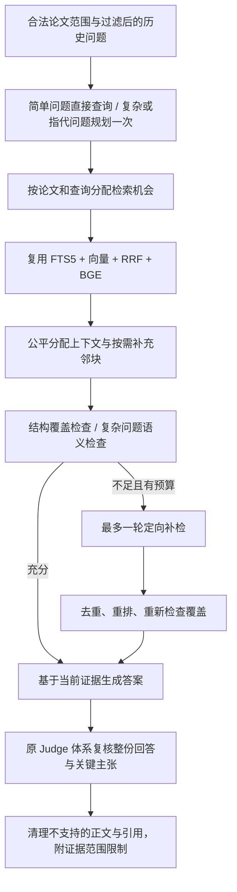

# 工作区智能问答：审计、改造与验证（2026-10-23）

本次为本地后端代码改造，未部署服务器，未提交或推送 GitHub。保留工作区中原有的前端修改。测试使用临时数据库和受控模型响应，没有对真实访客数据库执行迁移，也没有调用在线 MinerU / Embedding / 大模型进行生产验收。

## 1. 改造前实际调用链与问题

`POST /api/workspaces/{workspace_id}/conversations/{conversation_id}/messages`
→ `conversation_api.ask_conversation`
→ `conversations.begin` 校验工作区成员、解析 ID 别名、保存当次论文范围快照和 pending 消息
→ `conversations.get`，只保留历史论文集合是当前集合子集的已完成问题（最多三轮）
→ `hybrid.index_abstracts`
→ `attribution.answer_question`
→ `hybrid.retrieve`
→ 答案生成及独立 Judge 调用
→ `conversations.finish` 保存响应。

审计确认：

- 原混合检索为 FTS5（unicode61）关键词召回、Python 余弦向量检索、RRF（k=60）融合和现有 BGE reranker。向量不是此链路的 FAISS 搜索，而是 `paper_chunks.vector` 中的 JSON 数组。
- QA 原分块为 2400 字符窗口、400 字符重叠。全文解析结构保存在 `paper_documents.structure`，正文保存在 `paper_documents.text`；元数据和别名分别在 `papers`、`paper_keys`。
- Embedding 复用 `embeddings.embed_many`，缓存键包含模型和文本。默认模型为 `BAAI/bge-m3`，运行时仍由 `SILICONFLOW_EMBEDDING_MODEL` 决定；本次没有修改模型、密钥、服务或重排配置。
- 原 QA 把最近历史问题与新问题拼成一次查询，对全部所选论文一起检索。每篇最多 3 块只能限额，不能保证每篇获得检索机会；全局 Top 10 也不能确保覆盖全部选中论文。
- 生成上下文只使用前 12 条证据，而 Judge/返回值可能接收更多，存在实际生成上下文和证据池不一致的问题。
- 原 Judge 会移除 `claims` 中未获支持的主张，却不重建最终答案；部分错误主张仍可能留在原答案文字中。没有返回复核的主张也缺少保守处理。
- 现有 `judge_claims` 是独立提示词和独立调用，实际仍复用 `llm.complete` 的现有模型配置，并不是另建了一个模型服务。本次保留此方式。
- MinerU 路径为 `processing.process → parse_paper → documents.save`；上传路径为 `upload.ingest_pdf → parse_paper → library.save_paper(document=...) → documents.save_in_transaction`。解析成功后的原自动索引调用的是 `index_paper` 的 800/100 字符分块与 `vectors.faiss`，不是 QA 的 `paper_chunks`。
- `attribution.decompose/plan_search` 和 `tools.decompose_question` 也已审计：它们用于发现新的论文、生成外部论文搜索计划，包含年份/数量/布尔检索视角等契约，不负责当前所选论文的正文取证与比较维度。未改造或复用这些外部发现契约来承担 QA 规划，避免影响现有检索助手。

## 2. 实际实现的工作流



- `Plan` 严格校验问题类型、direct/rewrite/decompose/per_paper 策略、完整问题、查询、论文集合与维度。非法 JSON、非法论文 ID、超预算和超时回退原问题；模型不能扩大或缩小待比较的论文范围。
- 后端固定每次调用检索器的单论文 SQL 范围，最多支持 API 原有的 40 篇；不采用全库召回后再靠提示词过滤。
- 多查询的首条证据轮流进入候选，避免第一子问题占满上下文。多论文先给每篇第一条证据，再分配第二条；没有相关证据的论文明确缺失。
- 补检最多一轮，与 Judge 的最多两轮复核分别计数。补检合并结果去重，复用 BGE 重排，再按论文公平分配上下文。
- 方法/实验细节按需查询同论文、同正文版本的相邻块，不加载全部论文的所有向量来找邻块。邻块也计入每篇和总上下文限额。
- 复杂问题检查比较维度、各论文覆盖和摘要/正文边界。覆盖检查模型失败会保守标记未确认覆盖，不认证为充分。
- 全部实际生成证据都进入生成和 Judge 的同一证据池。保留 `[E0001]` 格式；证据新增可选 `basis/page_start/page_end`，仍有论文 ID、chunk ID、段落/块 ID 和章节。
- Judge 同时核验关键主张和整份回答，不复核通过或未返回结论的内容不会原样释放。部分主张被拒绝后，用剩余已支持主张重建正文；保留答案时引用仅采用 Judge 批准的真实证据 ID。跨论文整体结论还要求覆盖相应论文的证据来源。
- 历史问题继续仅用于理解指代，不作为论文事实证据；本次没有把历史回答重新灌入证据池。

## 3. 全文 QA 索引生命周期

`documents.save_in_transaction` 在保存正文的同一事务内写入 `qa_index_jobs`，不在保存事务里访问外部模型。

现有普通 `processing.worker` 和演示访客 `demo.workers` 的 processing 分支消费这张队列表；未增加独立常驻服务。启用原有论文处理 worker 后，会自动处理已保存的全文，不需要点击深读。旧版已解析文档由每轮最多 20 条的 reconciliation 补队。

状态为 `pending → running → ready / failed`：

- 文本、结构和分块版本形成内容 revision，Embedding 模型单独记录；重复保存同版本成功文档不会重复生成分块。
- 复用现有 2400/400 字符分块器：优先按 MinerU 章节和文本块组织，长块继续窗口切分，保留块 ID、顺序、物理页码。无可靠结构时从 Markdown 段落/标题提取，未知页码保持 null。
- 新分块版本为 `sections-c2400-o400-v2`，仍可读取旧 `c2400-o400-v1`。既有分块新增 basis、块序号、页码和 source_hash，旧记录来源默认为 unknown，不强行宣称来自全文。
- Embedding 完整且非空、维度一致、数值有效后，才在单事务内替换该论文的 QA 分块与 FTS；不把半成品写成 ready。
- 写入前再次检查 revision、当前题录 canonical ID 和模型。旧异步任务不能覆盖新文档或别名更新后的索引。
- 题录 ID 由 S2 升级到 arXiv 等情况会重新对齐任务与 QA 分块，清理同一 local_id 的旧 QA 分块/FTS，不碰其他论文或 FAISS。
- 失败保留旧摘要或旧可用正文；默认总共最多尝试三次，失败后退避，重新保存可显式重启失败任务。running 租约过期后可重新领取；取消时回到 pending。
- `ready` 只在 QA 分块和 FTS 事务提交时写入，与原 FAISS 的 completed 状态分别管理；问答的可选 `retrieval.index_status` 提供 QA 状态、尝试次数和失败信息。
- 使用摘要/来源不确定的证据时，答案明确标注边界；有新正文尚未就绪而使用旧正文时，标明当前依据此前版本。

本次不重建或合并 800/100 分块、`vectors.faiss`、相似度、关系缓存或知识图谱。

## 4. 文件与职责

| 文件 | 变更 |
|---|---|
| `backend/app/services/retrieval/qa_workflow.py` | 新增规划、覆盖检查、逐篇/逐查询分配、一次补检及上下文预算 |
| `backend/app/services/retrieval/qa_index.py` | 新增持久任务、结构分块、完整向量校验、原子替换、恢复与旧文档补队 |
| `backend/app/services/retrieval/hybrid.py` | 保留原检索引擎；兼容新旧分块与来源元数据，邻块 SQL 查询，空范围拒绝全库回退，防止旧写入降级全文索引 |
| `backend/app/services/analysis/attribution.py` | 接入取证流程，保留生成/Judge，修正实际正文和引用清理 |
| `backend/app/services/papers/documents.py` | 正文落库时同事务入队 |
| `backend/app/services/papers/processing.py` | 普通 worker 消费 QA 索引任务，队列异常不终止原处理器 |
| `backend/tests/test_qa_workflow.py` | 规划、指代、公平取证、40 篇范围、一次补检、引用/Judge、真实工作区 API 集成 |
| `backend/tests/test_qa_fulltext_index.py` | 自动 worker、MinerU 成功/失败、正文检索、幂等、缺失向量、事务回滚、取消/过期恢复、别名与模型更新、访客隔离 |

未修改既有对话 API 路由、调用参数、论文范围快照、历史筛选代码或原有测试断言。响应只增加可选诊断字段。

## 5. 默认预算与配置

| 环境变量 | 默认值 | 限制 |
|---|---:|---|
| `QA_MAX_QUERIES` | 3 | 每轮 1–3 条查询；子问题与改写语义区分 |
| `QA_MAX_RETRIEVAL_CALLS` | 80 | 原问题和唯一补检轮共享检索器调用上限，配置范围 40–120 |
| `QA_RETRIEVAL_CONCURRENCY` | 4 | 检索器最大并发，1–8 |
| `QA_CHUNKS_PER_PAPER` | 4 | 每篇上下文分块上限，1–6，包含邻块 |
| `QA_EVIDENCE_CHUNKS` | 48 | 总证据块预算，40–80 |
| `QA_CONTEXT_CHARS` | 24000 | 总文本上下文预算，8000–48000 |
| `QA_PLAN_TIMEOUT` | 45 | 规划/覆盖检查单次超时秒数，1–90 |
| `QA_MAX_ANSWER_CHARS` | 8000 | 展示并整体复核的答案字符上限，2000–10000 |
| `QA_MAX_CLAIMS` | 12 | 单独复核关键主张数量上限，1–24 |

逻辑 LLM 调用最多为规划 1 次、覆盖检查 2 次、生成 1 次和 Judge 2 次；简单问题可省去规划与语义覆盖调用。现有 LLM 层的网络重试策略仍由原组件控制。FAISS/Embedding 服务配置保持原样。

## 6. 实际测试与基线核验

改造前在 backend 目录执行：

```powershell
..\.venv\Scripts\python.exe -m pytest tests/test_attribution.py tests/test_hybrid.py tests/test_qa_scope.py tests/test_conversations.py tests/test_parse_tool.py tests/test_index_tool.py tests/test_agent_native_flow.py -q --basetemp .qa-tmp-baseline
```

结果：**60 passed**。

最终相关回归：

```powershell
```

结果：**175 passed，5 subtests passed**。包括真实 SQLite/FTS 和 ASGI 工作区对话 API 集成；外部模型、Embedding 和 MinerU 使用受控替身。另一次禁止外网的相关回归为 182 项通过，该次包含知识图谱模块；图谱模块单独运行也曾为 13 项通过，但其旧有顺序缺陷仍见下文，不能据此宣称始终稳定。

最后针对 `test_qa_workflow.py`、`test_qa_fulltext_index.py`、`test_attribution.py` 再次执行边界回归，结果为 **47 passed，5 subtests passed**，覆盖最后的索引状态提示调整。

完整离线套件也已实际执行，检查时版本为 **617 项，46 个 failure、4 个 error**；因此全仓测试不是全绿。使用 `git archive HEAD backend/app` 导出未改造代码到隔离路径，运行全部原有 580 项测试，得到 **45 个 failure、4 个 error**。原有失败/错误逐项都存在于完整新代码结果中，没有删除测试或放宽断言。

两次完整检查分别额外出现图谱 similar/citations 缺边失败。已在未修改旧代码下固定导入时间戳和论文 UUID，分别稳定复现：原图谱边构建时尚未建立所有目标别名，结果依赖论文顺序。未将此问题伪装为 QA 回归，也未扩大本次范围修改图谱实现。

核验日志/结构化结果保存在工作区 `.qa/rag-baseline-result.json`、`.qa/rag-current-result.json`、`.qa/rag-*-offline.log` 和 `.qa/graph-*-baseline-repro.log`。现有 `tests/run_offline.py` 及本次基线对照入口阻断真实外网调用。`git diff --check -- backend/app backend/tests` 通过。原有测试未删除、修改或跳过。

## 7. 兼容性与尚未验证部分

- 前端及其未提交修改保留；本次没有运行前端构建，因为不包含前端代码变更。
- 对话 API、`/api/qa`、论文选择、范围快照和历史隔离保持兼容；空选择不能成为全库查询，改写与补检都没有扩权。
- 继续复用当前生成/Judge 与 `[E0001]` 引用体系；未重写检索助手 LangGraph、工具循环、SSE、取消/恢复逻辑。当前 native finder 的回归通过；旧 Agent 测试仍有上述基线失败，不能宣称所有旧路径都已获全绿验证。
- FAISS、相似度、论文关系、访客隔离已运行相关测试；图谱存在已复现的历史顺序缺陷，另行处理。
- 规划与语义覆盖仍受模型质量影响；失败采用保守降级，不保证所有复杂问题都能得到完整结论。
- FTS5 仍为原 unicode61，并未引入中文分词。40 篇论文的预算公平分配已测试；真实大规模全文的延迟、内存、存储增长和模型成本尚未线上压测。
- 真实 MinerU 解析、实际 BGE/重排和在线生成/Judge 的端到端质量、生产迁移及服务器发布均未执行。上线后需启用现有论文处理 worker，观察 QA 任务状态与失败日志，并对代表性全文问题做真实验收。
